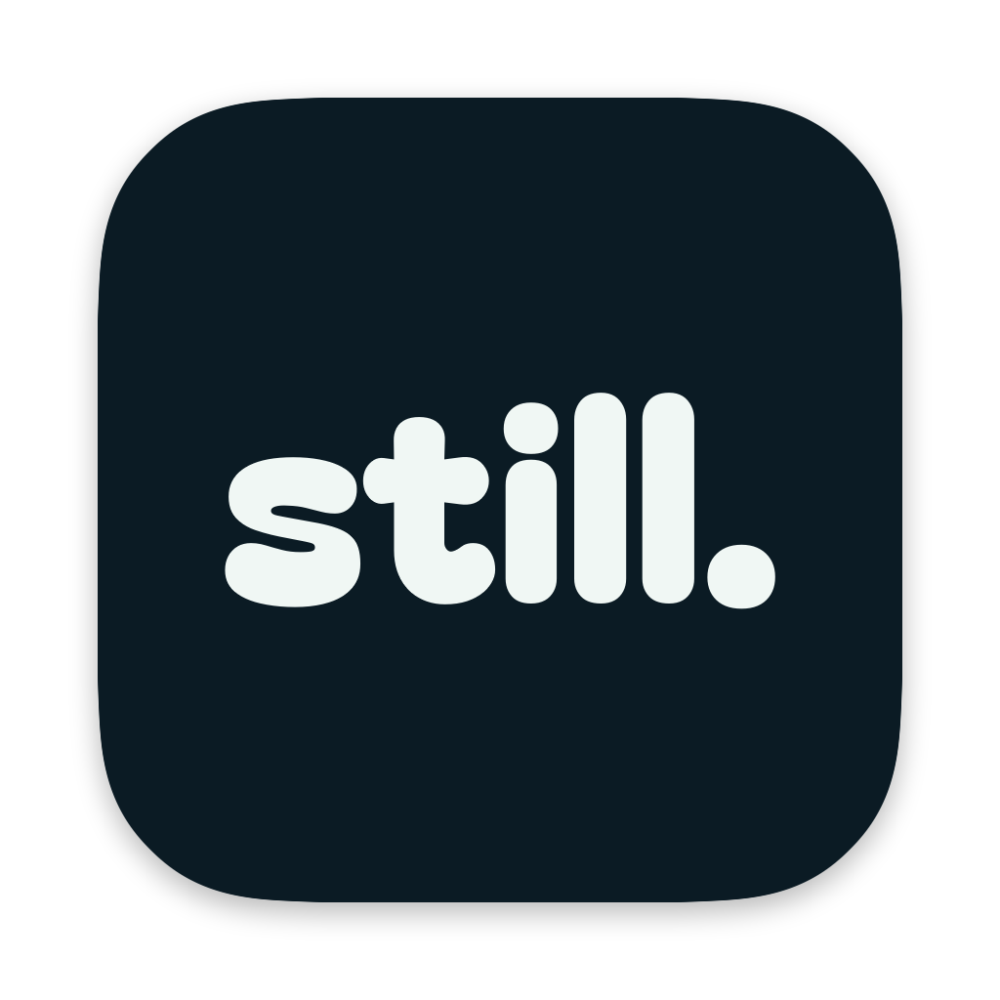
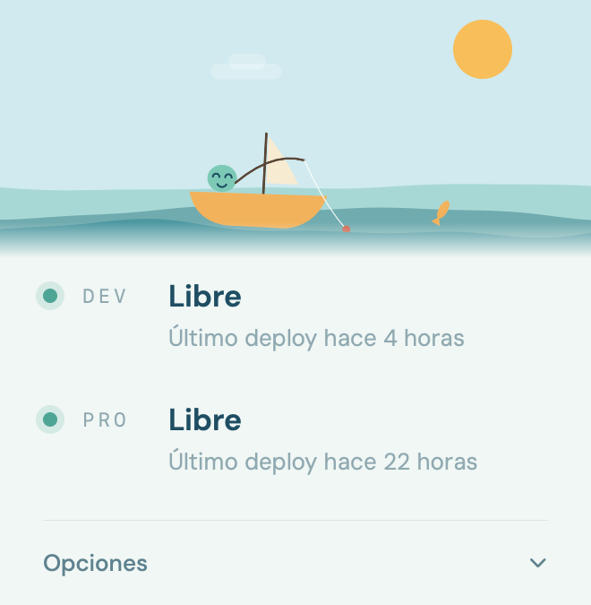
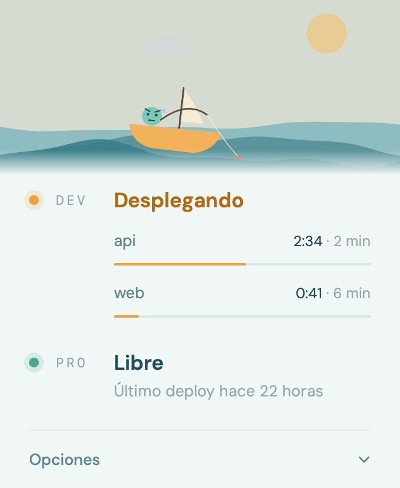
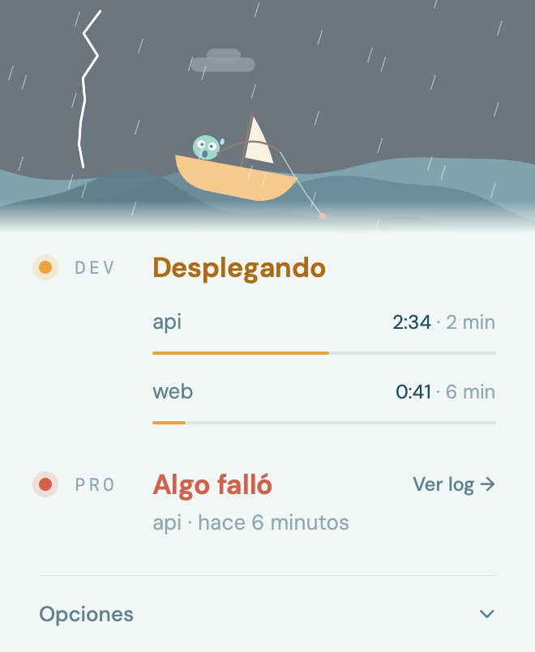

<p align="center"></p>

# still.

<p align="center">
  <picture>
    <source media="(prefers-color-scheme: dark)" srcset="https://raw.githubusercontent.com/albertoPicasso/still/main/Assets/screenshots/libre-dark.png">
    
  </picture>
  <picture>
    <source media="(prefers-color-scheme: dark)" srcset="https://raw.githubusercontent.com/albertoPicasso/still/main/Assets/screenshots/desplegando-dark.png">
    
  </picture>
  <picture>
    <source media="(prefers-color-scheme: dark)" srcset="https://raw.githubusercontent.com/albertoPicasso/still/main/Assets/screenshots/fallo-dark.png">
    
  </picture>
</p>

App de barra de menú para macOS que muestra un semáforo por entorno (por defecto DEV → `develop` y PRO → `main`) a partir de los workflows de GitHub Actions.

- Verde: libre. Ámbar: hay pipelines en marcha o en cola. Rojo: el último run de algún workflow falló (durante las horas configuradas).
- Pulsa en un pipeline para abrirlo en GitHub.

## Requisitos

- Un Mac con Apple Silicon y macOS 15 o superior
- [GitHub CLI](https://cli.github.com) con sesión iniciada: `brew install gh` y `gh auth login`

**Still necesita que `gh` esté configurado**: instalado y con la sesión iniciada. Comprueba que `gh auth status` muestra tu cuenta. La app detecta esa sesión sola y la usa para leer tus pipelines; sin ella no verá nada. No guarda tokens propios.

## Instalar

1. Descarga `Still.dmg` de la [última versión](https://github.com/albertoPicasso/still/releases/latest).
2. Ábrelo y arrastra **Still** a la carpeta Aplicaciones.
3. Abre la app. La primera vez macOS la bloqueará con un aviso de "desarrollador no identificado", porque todavía no está firmada con una cuenta de Apple Developer. Ve a **Ajustes del Sistema → Privacidad y seguridad**, baja hasta el aviso de still. y pulsa **Abrir igualmente**.

Si prefieres saltarte el aviso desde la Terminal:

```bash
xattr -dr com.apple.quarantine /Applications/Still.app
```

### Compilarla tú

Necesitas las Command Line Tools (`xcode-select --install`); no hace falta Xcode.

```bash
./build.sh --install
```

Compila, copia la app a `/Applications` y la abre. Para solo compilar: `./build.sh` (deja la app en `build/`). Para crear el `.dmg`: `./build.sh --dmg`.

## Configurar

Abre el desplegable → **Ajustes**:

- **Perfiles**: cada perfil es una cuenta u organización con sus repos y entornos. Cambia de perfil desde el desplegable.
- **Entornos**: nombre, rama y, opcionalmente, un texto que debe contener el nombre del workflow (por ejemplo `PRODUCTION`).
- **Repos vigilados**: marca los repos que quieres seguir. Los repos nuevos no se añaden solos.
- **Preferencias**: frecuencia de consulta, cuántas horas se mantiene el rojo y abrir al iniciar sesión.
